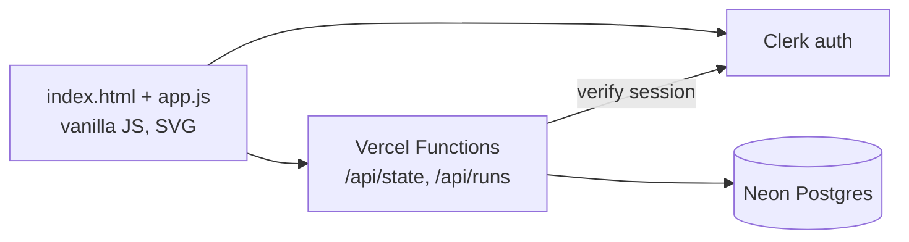

# Sixty: one habit, one day at a time

A minimal habit tracker built around a single 66-day challenge. Pick one thing worth doing every day, mark each day, and watch the path light up behind you. Finished and abandoned challenges stay in your history.

**Live:** https://habit-master-gilt.vercel.app (invite-only sign-up)

## Features

- **One habit, one challenge**: a fixed 66-day run with phases and motivational quotes tuned to that length.
- **Animated progress path**: hand-tuned SVG and DOM animations in plain JavaScript, no framework.
- **Accounts and sync**: sign in with Clerk (restricted, invite-only sign-up), data stored server-side so it survives a new device.
- **History**: every run ends as `finished` or `abandoned` and is kept, so the app remembers what you have already done.
- **Migration**: on first login the existing `localStorage` state is imported, nothing gets lost.

## Architecture



Design decisions worth noting:

- **Kept vanilla on purpose.** A rewrite to Next.js was considered and rejected: about 700 lines of hand-tuned DOM, SVG paths and timings would carry a high regression risk for exactly the part that matters most here.
- **Calendar dates, not day indexes.** A completed day is stored as a real date, which keeps resets, gaps and time zones unambiguous.
- **One active run per user** is enforced in the database with a partial unique index, not in application code.
- `goal_days` exists as a column even though the UI fixes it to 66, so making it configurable later needs no migration.

Full design notes (in Slovak) are in [`docs/`](docs/).

## Tech stack

Vanilla JavaScript, HTML/CSS, SVG animations, Vercel Functions, Clerk, Neon serverless Postgres.

## Data model

```sql
run      (id, user_id, habit_name, goal_days, start_date, status, ended_at, created_at)
run_day  (id, run_id, date)   -- unique (run_id, date)
```

See [`schema.sql`](schema.sql).

---

Built by [Andrej Meliška](https://andrej.meliska.sk/).
